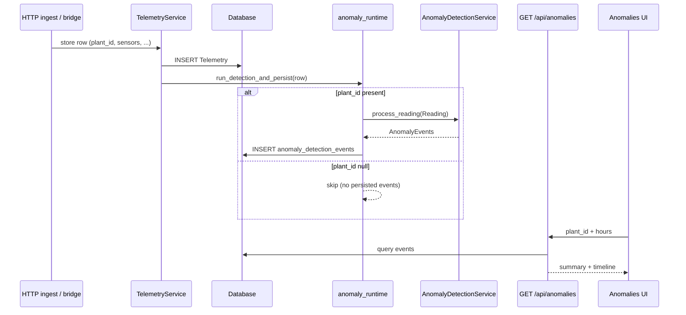

# Anomaly Detection (FR10) — Implementation Guide

**Owner:** Omer  
**Stack:** FastAPI ingest, SQLite (or configured DB), in-process detectors  
**UI:** TerraMetric View Data → Anomalies (+ synthetic lab endpoint)

---

## 1. Purpose

Surface **explainable**, **threshold-driven** anomalies on environmental telemetry (**temperature**, **humidity**, **light**). Methods are classical rules / small-window statistics—not a separately trained classifier—so coursework claims should be framed as **sensitivity vs false alarms** under chosen thresholds and sampling, not headline “accuracy” without a labelled test set.

---

## 2. Data path (live)

1. Telemetry reaches the backend via authenticated HTTP ingest (device / Pi bridge paths as deployed).
2. `TelemetryService` persists each row (`plant_id`, `session_id`, timestamps, sensor fields).
3. `run_detection_and_persist` (**`backend/services/anomaly_runtime.py`**) runs the shared `AnomalyDetectionService` and writes rows to **`anomaly_detection_events`**.

### 2.1 `plant_id` requirement (persisted events)

Live persistence **requires** `Telemetry.plant_id`. If ingest stores rows with `plant_id=NULL`, detectors are **skipped** for that row and **no DB events** are created. Operational fixes:

- Start a **recording** for the sample (Manage Samples) so the ingest pipeline attaches `plant_id`, **or**
- Configure the bridge / device payload so `plant_id` is sent (e.g. `TM_BRIDGE_PLANT_ID` — see **`docs/setup-guide.md`**, **`docs/pi-setup.md`**).
- Historical rows missing `plant_id`: after ingest is corrected, **`POST /api/anomalies/reprocess?plant_id=…&hours=…`** replay the window onto the detectors.

---

## 3. Detector sets (default vs extended)

Orchestrator: **`backend/services/anomaly_service.py`**.

| Set | Detectors | When active |
|-----|-----------|-------------|
| **Core (default)** | Dropout → Spike → Drift → Noise | Live ingest, reprocess, and unit tests (`extended_detectors=False`) |
| **Extended** | + Correlation, CUSUM (level shift), EWMA breach, Seasonal | `FR10_EXTENDED_DETECTORS=true` in **`backend/.env`** (`backend/config.py`); **always** enabled for **`POST /api/anomalies/simulate`** (lab uses an ephemeral full service instance) |

**Why split:** Core detectors have straightforward hypotheses (missing data, outliers, drifting mean, inflated variance). Correlation / CUSUM / EWMA / seasonal lean on sampling regularity or structure; keeping them optional supports a narrower **false-positive evaluation** baseline on live hardware before turning extended rules on.

---

## 4. API surface (frontend-relevant)

| Endpoint | Role |
|---------|------|
| `GET /api/anomalies?hours=&plant_id=` | Aggregated counts + events for charts / table |
| `POST /api/anomalies/simulate` | Synthetic lab (**not persisted**); all detectors incl. extended |
| `POST /api/anomalies/reprocess` | Delete events in window, replay telemetry through **live** singleton (core or extended per env) |
| `DELETE /api/anomalies/clear` | Resets singleton lab session key (`99`) only; does not wipe DB |

---

## 5. Hardware context

| Sensor | Variable | Notes |
|--------|----------|-------|
| DHT11 | temperature, humidity | May send `null` on failure; shared physical coupling between temp & humidity |
| LDR | light | Raw-ish scale (not calibrated lux in code) |

PIR / distance are ignored by FR10 orchestration (non-continuous for these rules).

---

## 6. Algorithm sketch (core)

Thresholds largely mirror **`backend/config.py`** and **`services/detectors/base.py`** / `SensorProfile`.

### 6.1 Dropout

Gap between timestamps vs learned median inter-arrival (first N gaps). Severity bands use `DROPOUT_MULTIPLIER` and configured warning/critical thresholds.

### 6.2 Spike

Z-score style outlier vs short buffer + physical bound checks (`SpikeDetector`).

### 6.3 Drift

Least-squares slope on a sliding window of readings per variable vs per-variable slope thresholds (`DRIFT_WINDOW_SIZE`, `DRIFT_SLOPE_THRESHOLD_*`).

### 6.4 Noise

Rolling standard deviation vs baseline noise in `SensorProfile`, compared at **`NOISE_MULTIPLIER_WARNING`** / **`NOISE_MULTIPLIER_CRITICAL`** after **`NOISE_WINDOW_SIZE`** readings.

### 6.5 Extended detectors (summary)

- **Correlation:** Rolling Pearson consistency between temperature and humidity streams; cooldowns reduce duplicate alerts.
- **CUSUM / level shift:** Cumulative-sum style mean shift detection on profile-scaled residuals.
- **EWMA:** Smoothed mean vs control limits; breach events with cooldown.
- **Seasonal:** Hour-of-day residual logic on light (assumes enough samples per bucket).

Implementations: **`backend/services/detectors/`**.

---

## 7. Evaluation & false-positive study (coursework-ready)

These detectors are **not** probabilistic classifiers with an intrinsic accuracy metric. Recommended reporting:

1. **Define negatives:** stable windows (Arduino bench, chamber steady state, or `stable` / low-injection synthetic series).
2. **Define positives:** injected faults (`POST /api/anomalies/simulate` scenarios — tabulate expected detector families), or scripted injects with known onset times on bench data.
3. **Metrics:**
   - **Events per hour** on negative windows (“false positives” if no intentional fault).
   - **Time-to-detection** or **recall proxy** on positive segments (manual segment labels on a timeline is enough at coursework scale).
   - Optionally **precision** if injections are sparse and countable.
4. **Threshold sweep:** vary `NOISE_MULTIPLIER_*`, drift slope multiples, dropout multiplier (via env / code) and log changes in FP rate vs missed injections.
5. **Synthetic vs live:**
   - **Synthetic lab** exercises the **full** orchestrator incl. extended rules; results are **not** written to DB.
   - **Live/reprocess** use the deployed detector set (core unless `FR10_EXTENDED_DETECTORS`), so summaries between lab and persisted events are **not** identical unless extended is enabled on the server.

**SQL-shaped idea:** for a stable evaluation window with known `plant_id`, count rows in `anomaly_detection_events`, group by hour or by `anomaly_type`, and join to telemetry bins for context (adapt to your dialect).

---

## 8. Performance

Per-reading cost is bounded: each detector touches fixed-size windows (order 10–30 samples). Synthetic simulate cost scales linearly with generated points (`duration_min × interval_sec`).

---

## 9. Known limitations

- Detector **state is in-memory** on the singleton service; backend restart ⇒ warm-up again.
- **Multiple detectors may fire on the same reading**; UI triage aids (severity, filters, “reviewed” in browser storage) do not fuse alerts server-side.
- **LDR** units are deployment-relative; seasonal baselines inherit that caveat.
- **Reprocess** uses the **current code and env detector set**, not necessarily the set active when data was originally ingested.

---

## 10. Mermaid — live ingest to UI

---

## 11. Design decisions

| Decision | Rationale |
|----------|-----------|
| Core vs extended split | Stable baseline for reproducible coursework evaluation; extended available when assumptions hold |
| Spike + dropout before drift/noise ordering | Gap and single-reading faults surface before slower windows fill |
| Readings-based windows | Tolerates slightly irregular sampling (dropout still uses wall-clock gaps) |

---

Document version aligns with codebase as of TerraMetric coursework tree; thresholds live in **`backend/config.py`** and **`SENSOR_PROFILES`**.
