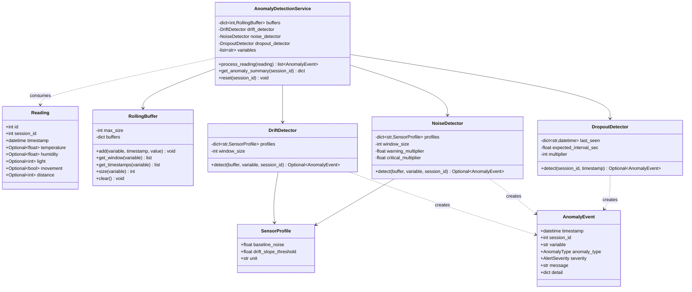
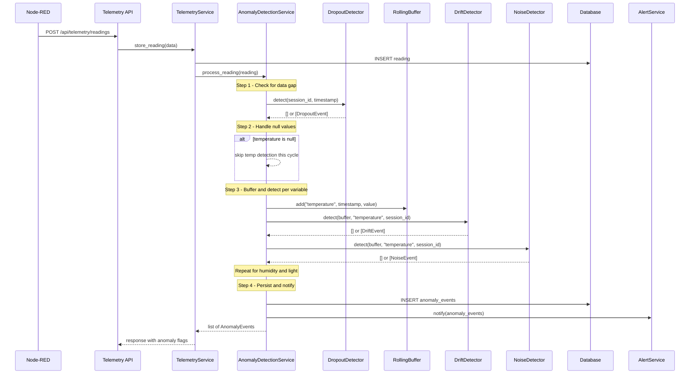
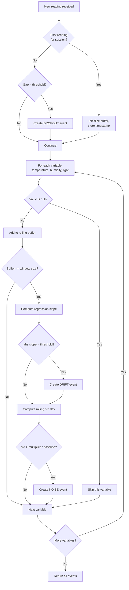

# Anomaly Detection Module -- Design Document

**Owner:** Omer
**FR:** FR10 -- Anomaly Detection Layer
**Status:** Implementation in progress

---

## 1. Purpose

Detect data anomalies in real-time as sensor readings arrive from the Arduino via Node-RED. Three anomaly types are supported:

- **Drift** -- gradual sensor calibration loss over time
- **Noise** -- increased reading jitter from sensor degradation
- **Dropout** -- gaps in data from connectivity or power loss

Detection runs independently for each environmental variable: temperature, humidity, and light.

---

## 2. Hardware Context

| Sensor | Variable | Type | Accuracy | Notes |
|--------|----------|------|----------|-------|
| DHT11 | temperature | float | +/-2 C | Sends `null` on read failure. Updates every ~2s despite 200ms loop. |
| DHT11 | humidity | float | +/-5 %RH | Same physical sensor as temperature. |
| LDR (A0) | light | int 0-1023 | uncalibrated | Raw analog read. Inherently noisy. |
| PIR | movement | bool | n/a | Not used for anomaly detection. |
| HC-SR04 | distance | int cm | n/a | Not used for anomaly detection. |

The Arduino transmits JSON every 200ms. Node-RED forwards to the backend at a rate determined by its flow configuration. The anomaly detection module does not assume a fixed sampling rate -- it detects the interval dynamically.

---

## 3. Architecture

### 3.1 Class Diagram



### 3.2 Sequence Diagram -- Real-time Processing



### 3.3 Activity Diagram -- Per-Reading Processing



---

## 4. Algorithm Specifications

### 4.1 Drift Detection -- Linear Regression Slope

**Problem:** Sensor calibration degrades over time. Readings gradually shift from truth.

**Method:** Fit a least-squares line to a sliding window of readings. If the slope exceeds a threshold, the sensor is drifting.

**Formula:**

Given N readings in the window (x = index, y = value):

```
slope = (N * sum(x*y) - sum(x) * sum(y)) / (N * sum(x^2) - sum(x)^2)
```

Implemented via `numpy.polyfit(x, y, 1)[0]`.

**Thresholds:**

| Variable | Threshold | Reasoning |
|----------|-----------|-----------|
| Temperature | 0.05 C/reading | At 1 reading/min, this is 3 C/hour -- abnormal for a sealed chamber |
| Humidity | 0.5 %RH/reading | DHT11 has +/-5%RH accuracy and high noise (std ~2.0). Threshold must exceed 3x the regression standard error for noise of this magnitude to avoid false positives. |
| Light | 3.0 units/reading | LDR is noisy; higher threshold avoids false positives |

**Window size:** 30 readings. Balances early detection vs false positives.

**Severity:** WARNING if slope is 1-2x threshold. CRITICAL if > 2x.

### 4.2 Noise Detection -- Rolling Standard Deviation

**Problem:** Sensor degradation causes readings to become increasingly jittery.

**Method:** Compute standard deviation of a sliding window. Compare against known baseline noise for the sensor.

**Formula:**

```
std = sqrt( (1/N) * sum((xi - mean)^2) )
```

Implemented via `numpy.std(values)`.

**Baselines (from datasheets and empirical observation):**

| Variable | Baseline Std Dev | Source |
|----------|-----------------|--------|
| Temperature | 0.5 C | DHT11 resolution is 1C; normal fluctuation ~0.5 |
| Humidity | 2.0 %RH | DHT11 accuracy +/-5%RH; normal jitter ~2 |
| Light | 20 raw units | Analog read noise on Arduino A0 |

**Multipliers:** WARNING at 3x baseline. CRITICAL at 5x baseline.

**Window size:** 10 readings. Short enough for fast detection, long enough for statistical significance.

### 4.3 Dropout Detection -- Timestamp Gap Analysis

**Problem:** Bluetooth disconnects, Pi crashes, or power outages cause data gaps.

**Method:** Compare the gap between consecutive reading timestamps against the expected interval.

**Formula:**

```
gap = current_timestamp - previous_timestamp
expected = median of first 20 inter-reading intervals (dynamic)
if gap > multiplier * expected: flag dropout
```

**Severity:** INFO if 3-5x expected. WARNING if 5-15x. CRITICAL if > 15x.

---

## 5. Integration Contracts

### Contract 1: Input from Telemetry Service (Bo)

Bo's `telemetry_service.store_reading()` calls `anomaly_service.process_reading(reading)` after persisting each reading.

### Contract 2: Output to Alert Service (Harini)

Each `AnomalyEvent` can optionally trigger an alert via `alert_service.create_alert()`.

### Contract 3: Output to Frontend (Chris)

REST endpoints:
- `GET /api/anomalies?session_id=X` -- paginated list of anomaly events
- `GET /api/anomalies/active?session_id=X` -- currently active anomalies

### Contract 4: Output to Report Service (Jena)

`get_anomaly_summary(session_id)` returns:
- Total count by anomaly type
- List of all events with timestamps
- Time ranges affected by each anomaly

### Contract 5: Interaction with ESI Service (Bo)

Design decision: ESI does NOT exclude anomaly-flagged readings. Anomalies are reported alongside ESI, not used to filter ESI input. This keeps the two modules independent.

---

## 6. Sensor Profiles

Rather than scattering thresholds across config, each sensor has a `SensorProfile`:

```python
SENSOR_PROFILES = {
    "temperature": SensorProfile(baseline_noise=0.5, drift_slope_threshold=0.05, unit="C"),
    "humidity":    SensorProfile(baseline_noise=2.0, drift_slope_threshold=0.5, unit="%RH"),
    "light":       SensorProfile(baseline_noise=20.0, drift_slope_threshold=3.0, unit="raw"),
}
```

If the team later swaps DHT11 for BME280, only the profile changes.

---

## 7. Performance and computational complexity

The orchestrator runs **eight** statistical detectors per incoming reading (dropout, spike, drift, noise, correlation, CUSUM level-shift, EWMA, seasonal on light). Each detector uses **fixed-size windows** (`RollingBuffer` with maxlen on the order of 10–30 samples), so work per reading is **bounded** and does **not** grow with total experiment length.

- **Per-reading cost:** Roughly “sum over detectors of O(window)” — small NumPy operations on vectors of length ≤ 30. At typical greenhouse sampling (e.g. one reading per minute), CPU time is negligible on a Raspberry Pi class device compared to I/O (network, database).
- **Memory:** One buffer per session per monitored stream; eviction is automatic when the deque is full. Order tens of kilobytes for many concurrent sessions, not megabytes.
- **Latency:** The detection path is synchronous and contains **no** database or HTTP calls inside `process_reading()` itself. Persistence and alerts are integration concerns for production wiring.

**Simulation endpoint** (`POST /api/anomalies/simulate`) replays an entire synthetic series in a loop; runtime scales **linearly** with the number of generated points and is intended for validation and demos, not for batch reprocessing of years of archives.

---

## 8. Known limitations (honest scope)

- **Buffer state is in-memory.** Rolling windows and detector-specific state (CUSUM, EWMA, seasonal baselines) reset if the backend process restarts. Recovery is automatic as new readings arrive, but the **warm-up** period must elapse again before behaviour matches pre-restart.
- **Demo API store is in-memory.** `GET /api/anomalies` reflects the last simulation or pipeline run held in process RAM until cleared or the server restarts. Production would use the `Anomaly` SQLAlchemy model and pagination.
- **Dropout baseline** is learned from the first N inter-arrival gaps (median). If the **true** sampling interval changes mid-session (e.g. Node-RED throttle edited), the baseline can become stale until reset or enough new structure is observed.
- **LDR light** is treated in raw ADC-style units (0–1023), not calibrated lux; seasonal and noise baselines are therefore relative to the hardware as deployed.
- **Multiple detectors can fire on the same reading** (e.g. drift plus EWMA plus noise under aggressive scenarios). The UI does not yet merge these into a single “root cause” narrative; that would be a product-layer enhancement (alert fusion).
- **No automated false-positive learning** (no feedback loop from user labels into model weights). Tuning remains threshold- and window-driven.

---

## 9. False positives: what reduces them (and what does not)

**There is no separate “false positive classifier”.** Mitigation is by **design of rules**, **thresholds**, and **lightweight state machines**:

| Mechanism | Where | Effect |
|-----------|--------|--------|
| **Thresholds and severity tiers** | Drift slope vs profile; noise ratio vs baseline × multipliers; spike z-score / hard bounds; dropout gap ratio bands (INFO / WARNING / CRITICAL) | Reduces trivial flags; wrong tuning increases either false positives or false negatives. |
| **Noise: consecutive duplicate stripping** | `NoiseDetector` | Prevents DHT11-style repeated samples from **deflating** measured variance so noise is not under- or over-estimated. |
| **Dropout: learning phase** | `DropoutDetector` | No gap alerts until enough intervals collected; **median** interval resists one bad startup gap. |
| **Correlation: cooldown** | `CorrelationDetector` | After an alert, suppresses repeat correlation events for N readings to avoid log spam. |
| **EWMA: cooldown** | `EWMADetector` | Same idea after a control-limit breach. |
| **CUSUM reset** | `CUSUMDetector` | After a level-shift trigger, accumulators reset so one physical change does not generate unbounded repeats. |
| **Seasonal: minimum samples per hour** | `SeasonalDetector` | Avoids comparing to an hour-of-day baseline until enough data exists for that hour. |

**Not implemented:** user-confirmed “this was a false alarm” stored in the database, Bayesian model averaging, or ensemble voting across detectors. The **TerraMetric** HTML UI adds **client-side “reviewed”** flags (localStorage) so operators can hide events they have triaged during a session; that does not change backend scoring.

---

## 10. TerraMetric anomalies UI (operator aids)

The monolithic `Terrametric web.html` anomalies tab complements the API with:

- **Per-sensor charts** (separate Y-scales) and optional anomaly markers.
- **Score timeline** — per-timestamp sum of severity weights for a quick “when did things get loud?” view.
- **Filters** (type, severity, sensor), **text search**, **group-by-timestamp** mode, **pagination (load more)**, **mark reviewed** (persists in `localStorage` under `terrametric-anom-ack`), **focus timestamp** (highlights matching rows for cross-checking with charts).
- **CSV / print** export for lab notebooks.

These are **presentation and triage** layers; they do not replace scientific validation of thresholds against real chamber data.

---

## 11. Design decisions and justifications

| Decision | Chosen | Alternatives considered | Why |
|----------|--------|-------------------------|-----|
| Drift algorithm | Linear regression slope on a window | CUSUM-only | Explainable in coursework; CUSUM/EWMA added separately for level shifts and small sustained moves. |
| Noise algorithm | Rolling std dev vs profile baseline | Spectral / wavelet | Matches sensor noise story; dedup handles DHT11 sampling quirks. |
| Spike algorithm | z-score + hard physical bounds | IQR only | Catches impossible single samples (glitch bytes) and statistical outliers. |
| Cross-variable | Rolling Pearson r on temp vs humidity | Full multivariate model | Cheap and interpretable for one dual-sensor module. |
| Window units | Readings (not wall-clock) | Time-based only | Stable when sampling interval drifts slightly; dropout still uses real timestamps. |
| Buffer persistence | In-memory | Redis / DB | Project scope; document upgrade path for production. |
| Detector list | Pluggable `BaseDetector` list | Monolithic service | Open/closed: new rules append without rewriting orchestrator. |
