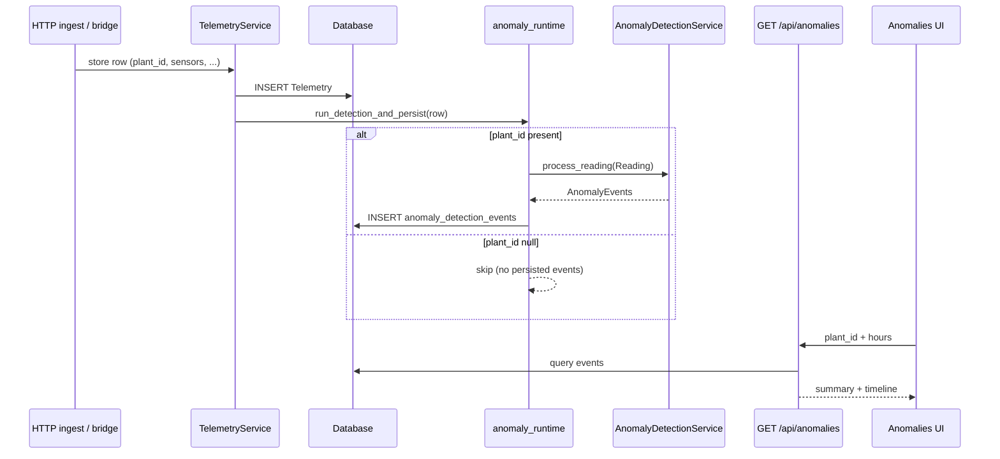

# Anomaly Detection (FR10) — Implementation Guide

**Owner:** Omer  
**Stack:** FastAPI ingest, SQLite (or configured DB), in-process detectors  
**UI:** TerraMetric View Data → Anomalies (+ synthetic lab endpoint)

---

## 1. Purpose

Surface **explainable**, **threshold-driven** anomalies on environmental telemetry (**temperature**, **humidity**, **light**). Methods are classical rules / small-window statistics—not a separately trained classifier—so coursework claims should be framed as **sensitivity vs false alarms** under chosen thresholds and sampling, not headline “accuracy” without a labelled test set.

---

## 2. Data path (live)

1. Telemetry reaches the backend via authenticated HTTP ingest (device / Pi bridge paths as deployed).
2. `TelemetryService` persists each row (`plant_id`, `session_id`, timestamps, sensor fields).
3. `run_detection_and_persist` (**`backend/services/anomaly_runtime.py`**) runs the shared `AnomalyDetectionService` and writes rows to **`anomaly_detection_events`**.

### 2.1 `plant_id` requirement (persisted events)

Live persistence **requires** `Telemetry.plant_id`. If ingest stores rows with `plant_id=NULL`, detectors are **skipped** for that row and **no DB events** are created. Operational fixes:

- Start a **recording** for the sample (Manage Samples) so the ingest pipeline attaches `plant_id`, **or**
- Configure the bridge / device payload so `plant_id` is sent (e.g. `TM_BRIDGE_PLANT_ID` — see **`docs/setup-guide.md`**, **`docs/pi-setup.md`**).
- Historical rows missing `plant_id`: after ingest is corrected, **`POST /api/anomalies/reprocess?plant_id=…&hours=…`** replay the window onto the detectors.

---

## 3. Detector sets (default vs extended)

Orchestrator: **`backend/services/anomaly_service.py`**.

| Set | Detectors | When active |
|-----|-----------|-------------|
| **Core (default)** | Dropout → **MissingChannel** → Spike → Drift → (optional light residual CUSUM) → Noise | Live ingest when `extended_detectors` is False; **`anomaly_detection_constructor_kwargs()`** in **`anomaly_service.py`** wires thresholds from **`backend/config.py`**. |
| **Extended** | + Correlation, CUSUM (level shift), EWMA breach, Seasonal | `FR10_EXTENDED_DETECTORS=true`; **always** enabled for **`POST /api/anomalies/simulate`** (full service instance). |

**Light residual CUSUM (optional core)** — emits **`LEVEL_SHIFT`** with `detail.reason = "core_light_residual_cusum"`. Controlled by **`FR10_CORE_LIGHT_RESIDUAL_CUSUM`**. It is **not** appended when **`extended_detectors`** is True, so the synthetic lab does not double-stack next to **`CUSUMDetector`**.

**Why split:** Core detectors have straightforward hypotheses (missing data, outliers, drifting mean, inflated variance). Correlation / CUSUM / EWMA / seasonal lean on sampling regularity or structure; keeping them optional supports a narrower **false-positive evaluation** baseline on live hardware before turning extended rules on.

---

## 4. API surface (frontend-relevant)

| Endpoint | Role |
|---------|------|
| `GET /api/anomalies?hours=&plant_id=` | Aggregated counts + events for charts / table |
| `POST /api/anomalies/simulate` | Synthetic lab (**not persisted**); extended rules + simulate-specific service build |
| `POST /api/anomalies/reprocess` | Delete events in window, replay telemetry through **live** singleton (core or extended per env) |
| `DELETE /api/anomalies/clear` | Resets singleton lab session key (`99`) only; does not wipe DB |

---

## 5. Hardware context

| Sensor | Variable | Notes |
|--------|----------|-------|
| DHT11 | temperature, humidity | May send `null` on failure; shared physical coupling between temp & humidity |
| LDR | light | Raw-ish scale (not calibrated lux in code) |

PIR / distance are ignored by FR10 orchestration (non-continuous for these rules).

---

## 6. Algorithm sketch (core) — formulas

Thresholds mirror **`backend/config.py`**, **`SensorProfile`** in **`services/detectors/base.py`**, and constructor kwargs assembled by **`anomaly_detection_constructor_kwargs()`**.

Notation: \(x\) = current reading per variable (after buffering); priors exclude \(x\) when the buffer holds `window + 1` samples.

### 6.1 Dropout

Intervals \(g\) between timestamps; learn median baseline \(\tilde{t}\) from the first **`DROPOUT_BASELINE_READINGS`** gaps. Flag if \(\frac{g}{\tilde{t}} > \texttt{DROPOUT\_MULTIPLIER}\).

Severity tiers use **`DROPOUT_SEVERITY_WARNING`** and **`DROPOUT_SEVERITY_CRITICAL`** as multiples of \(\tilde{t}\). Tune these together with **`SAMPLING_INTERVAL_SEC`** / Pi bridge cadence documented in **`docs/pi-setup.md`** so transient Wi-Fi pauses classify as WARNING while long outages are CRITICAL.

### 6.2 Missing dead channel (`MissingChannelDetector`)

Consecutive **`null`** values on one monitored environmental field while ingest is otherwise healthy ⇒ **`MISSING_DATA`**.

Let **`MISSING_CHANNEL_CONSEC_WARNING`** = \(N_w\) and **`MISSING_CHANNEL_CONSEC_CRITICAL`** = \(N_c\) (\(N_c > N_w\)). For each ingest row:

- Per variable, increment a streak whenever the payload has `null` for that variable.
- Optional **`MISSING_CHANNEL_REQUIRE_PEER_SIGNAL` (default true):** only count streaks if **at least one other** monitored env field (`temperature`, `humidity`, `light`) is non-null **on that same row**—so dropout / unplugged-bus rows that are globally empty do **not** look like “one probe died while the rest streamed.” Single-sensor rigs can flip this flag to `false`.

Emit **WARNING** when the streak reaches \(N_w\); emit **CRITICAL** once when it reaches \(N_c\) (without spamming on every subsequent row until the channel recovers to non-null).

Disable entirely with **`MISSING_CHANNEL_ENABLED=false`**.

### 6.3 Spike (`SpikeDetector`)

1. Hard bounds (`HARD_BOUNDS` dict) ⇒ immediate CRITICAL.
2. Let \(\mu\) = mean(priors), effective scale \(\sigma_{\text{eff}} = \max(\hat{\sigma}, \sigma_{\text{floor}})\) where \(\sigma_{\text{floor}}=\texttt{baseline\_noise}/\texttt{SPIKE\_STD\_FLOOR\_DENOM}\), and \(\hat{\sigma}\) is either **`np.std(priors)`** or **MAD×1.4826** when **`SPIKE_USE_MAD=true`**.
3. Spike if \(\frac{|x-\mu|}{\sigma_{\text{eff}}} > \texttt{SPIKE\_WARNING\_Z}\) (**WARNING** vs **CRITICAL** at **`SPIKE_CRITICAL_Z`**).

Optional **`SPIKE_MIN_ABS_DELTA`** requires \(|x-\mu|\) exceed an absolute deviation (same units as the sensor)—useful alongside very small floors where only relative tests are too sharp.

Defaults target a **balanced** operating point: flatten tiny-σ hallucinations via the floor yet keep plausible single-sample faults visible.

### 6.4 Drift (`DriftDetector`)

OLS slope on **`DRIFT_WINDOW_SIZE`** points; when the buffer is longer than one extra sample, regression uses **`values[-(window+1):-1]`** (prior-only), decoupling the current point.

Let \(y_i\) be the windowed series, slope \(\beta\) from regressing \(y\) on \(\{0\ldots N-1\}\). Persist only if \(\lvert \beta\rvert > \texttt{sensor.drift_slope_threshold}\).

**\(R^2\) veto:** Reject drift if **`DRIFT_MIN_R_SQUARED`** is not achieved (parsimonious guards against jittery-but-flat overlays).

**Kendall (Mann–Kendall-style gate):** If **`FR10_DRIFT_MK_SUPPRESS=true`**, Kendall’s \(\tau\) (via **`scipy.stats.kendalltau`**) \(p\text{-value} >\) **`FR10_DRIFT_MK_P_MAX`** suppresses the drift (non-monotonic / oscillatory façade that can fake OLS slope).

### 6.5 Noise (`NoiseDetector`)

Rolling standard deviation \(\sigma_{\text{win}}\) on up to **`NOISE_WINDOW_SIZE`** **prior** samples (excluding the freshest point when extra history exists), after **stripping consecutive duplicate** DHT11 repeats inside the slice.

Trigger if \(\sigma_{\text{win}}/\texttt{baseline_noise}>\texttt{NOISE\_MULTIPLIER\_WARNING}\) (**WARNING**) or \(>\texttt{NOISE\_MULTIPLIER\_CRITICAL}\).

### 6.6 Optional core residual CUSUM (`LightResidualCUSUMDetector`)

Per-variable residuals \(z_t = \dfrac{x_t-\text{median}(\text{priors}_t)}{\texttt{baseline\_noise}}\).

Tabular symmetric CUSUM: \(S^+_{t}=\max(0,S^+_{t-1}+(z_t-\texttt{RESIDUAL\_CUSUM\_K}))\); \(S^-\) analogously downward. Threshold **`RESIDUAL_CUSUM_H`**. **`detail.reason = "core_light_residual_cusum"`** distinguishes synthetic lab’s full **`CUSUMDetector`** when both are inactive together.

### 6.7 Extended detectors (summary)

- **Correlation:** Rolling Pearson consistency between temperature and humidity streams; cooldowns reduce duplicate alerts.
- **CUSUM / level shift:** Full profile-scaled residuals with reset-on-fire semantics (see **`detectors/cusum.py`**).
- **EWMA:** Control-chart limits on EWMA smoothed mean; overlaps conceptually with sustained shifts—enable only when sampling is regular (see **`detectors/ewma.py`**).
- **Seasonal:** Hour-of-day residual logic on light (assumes enough samples per bucket).

---

## 7. Evaluation (pytest-first)

Automated proof lives in **`tests/test_anomaly.py`** and **`tests/test_simulation.py`**.

```text
pytest tests/test_anomaly.py tests/test_simulation.py -v
```

**What is covered:**

- **Steady / negative panels:** Stable rolling windows ⇒ no spike, drift R² veto on wobbly OLS ramps, Kendall suppression on oscillatory surrogates, dropout baselines respecting configured severity ratios.
- **Injections:** Oscillatory noise ⇒ noise detector; ramps ⇒ drift; gaps ⇒ dropout; single extreme points ⇒ spikes; sustained offsets ⇒ optional light residual CUSUM (`LEVEL_SHIFT`).
- **Consecutive nulls** on one channel with peers still posting ⇒ **`MISSING_DATA`** via **`MissingChannelDetector`** (see §6.2).

Manual **FP studies** (`GET /api/anomalies`) remain optional appendix material; keep lab vs live distinctions (simulate always runs extended; ingest obeys env).

Secondary idea (SQL): aggregate `anomaly_detection_events` by hour and `anomaly_type` joined to telemetry bins for deployment reports.

---

## 8. Performance

Per-reading cost is bounded: each detector touches fixed-size windows (order 10–30 samples). Synthetic simulate cost scales linearly with generated points (`duration_min × interval_sec`).

---

## 9. Known limitations

- Detector **state is in-memory** on the singleton service; backend restart ⇒ warm-up again.
- **Multiple detectors may fire on the same reading**; UI triage aids (severity, filters, “reviewed” in browser storage) do not fuse alerts server-side.
- **LDR** units are deployment-relative; seasonal baselines inherit that caveat.
- **Reprocess** uses the **current code and env detector set**, not necessarily the set active when data was originally ingested.

---

## 10. Mermaid — live ingest to UI



---

## 11. Design decisions

| Decision | Rationale |
|----------|-----------|
| Core vs extended split | Stable baseline for reproducible coursework evaluation; extended available when assumptions hold |
| Spike + dropout before drift/noise ordering | Gap and single-reading faults surface before slower windows fill |
| Prior-only windows (spike, drift, noise when possible) | Avoids self-influence of the candidate reading in baselines and regression |
| Balanced defaults in `config.py` | Floor on spike scale, R² drift veto, noise on priors—target plausible warnings while trimming obvious FPs on flat traces |
| Light residual CUSUM behind flag | Change-point–style accumulation without forcing extended lab assumptions on every deployment |
| `anomaly_detection_constructor_kwargs()` | Single mapping from `.env` → service constructor (runtime + simulate stay aligned) |
| Missing-channel detector after dropout | Rows still arrive while one probe fails ⇒ **`MISSING_DATA`** before spike/drift on that lane |

## 12. Environment reference (`.env` / `config.py`)

| Variable | Role |
|----------|------|
| `DRIFT_WINDOW_SIZE` | OLS window length |
| `DRIFT_SLOPE_THRESHOLD_TEMP` / `_HUMIDITY` / `_LIGHT` | Per-variable slope caps (also in `SensorProfile`) |
| `DRIFT_MIN_R_SQUARED` | Minimum \(R^2\) for drift to fire |
| `FR10_DRIFT_MK_SUPPRESS` | Enable Kendall \(p\)-value suppression |
| `FR10_DRIFT_MK_P_MAX` | Suppress drift if \(p >\) this value |
| `NOISE_WINDOW_SIZE` | Rolling length for noise std |
| `NOISE_MULTIPLIER_WARNING` / `NOISE_MULTIPLIER_CRITICAL` | Ratio vs `SensorProfile.baseline_noise` |
| `DROPOUT_MULTIPLIER` | Minimum gap ratio vs learned median to flag |
| `DROPOUT_BASELINE_READINGS` | Gaps collected before detection |
| `DROPOUT_SEVERITY_WARNING` / `DROPOUT_SEVERITY_CRITICAL` | Gap ratio bands for INFO/WARNING/CRITICAL |
| `SPIKE_WARNING_Z` / `SPIKE_CRITICAL_Z` | Robust z thresholds |
| `SPIKE_STD_FLOOR_DENOM` | Denominator \(\sigma_{\text{floor}}=\texttt{baseline}/\texttt{SPIKE\_STD\_FLOOR\_DENOM}\) |
| `SPIKE_MIN_PRIOR` | Prior count before spike stats |
| `SPIKE_MIN_ABS_DELTA` | Optional absolute deviation gate (0 disables) |
| `SPIKE_USE_MAD` | Robust scale toggle |
| `FR10_CORE_LIGHT_RESIDUAL_CUSUM` | Enable optional **`LightResidualCUSUMDetector`** |
| `RESIDUAL_CUSUM_K` / `RESIDUAL_CUSUM_H` / `RESIDUAL_CUSUM_WINDOW` / `RESIDUAL_CUSUM_MIN_PRIOR` | CUSUM-lite hyper-parameters |
| `MISSING_CHANNEL_ENABLED` | Enable dead-channel detection |
| `MISSING_CHANNEL_CONSEC_WARNING` | Consecutive nulls before WARNING |
| `MISSING_CHANNEL_CONSEC_CRITICAL` | Consecutive nulls before CRITICAL |
| `MISSING_CHANNEL_REQUIRE_PEER_SIGNAL` | Require another env field non-null on the same row before counting |
| `FR10_EXTENDED_DETECTORS` | Correlation + full CUSUM + EWMA + seasonal |

Comments in **`backend/terrametric-laptop.env.example`** list the most common anomaly toggles alongside hardware keys.

---

## 13. Reprocess after tuning

Changing thresholds or detector flags **does not** rewrite existing `anomaly_detection_events` rows automatically. After deployment, run **`POST /api/anomalies/reprocess?plant_id=…&hours=…`** so stored telemetry is replayed through the **new** rules. Expect event counts to shift relative to legacy snapshots used in earlier coursework write-ups.

---

Document version aligns with TerraMetric coursework tree; authoritative defaults live in **`backend/config.py`** and **`SENSOR_PROFILES`**.
