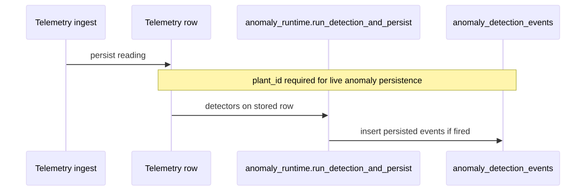

# CM2305 Individual Report — Evidence & Appendix Pack

**Module:** CM2305 Group Project — Individual Written Assessment  
**Brief constraints (confirm on Learning Central):** main report **≤5 pages** (12 pt); **references excluded** from limit; appendix **≤2 pages** containing **figures, tables + short captions only**.

**Purpose:** Paste-ready appendix captions, **embedded diagram images**, source Mermaid files to regenerate exports, placeholders, and command templates for TerraMetric.

**Embedded diagrams:** The sections below render **SVG images** from `docs/images/` (committed in-repo). Cursor/VS Code, GitLab, and many Markdown previews **show graphics directly**. For Word/PDF appendix, drag `docs/images/*.svg` into the document or export to PNG via browser (open the `.svg` file → screenshot or print).

**If a preview blocks SVG:** open **`docs/images/cm2305-a1-architecture.svg`** and **`docs/images/cm2305-a6-anomaly-sequence.svg`** directly in Chrome/Edge.

**Regenerate SVGs:** Edit `docs/diagrams/*.mmd`, then POST to [Kroki](https://kroki.io) or use `@mermaid-js/mermaid-cli` (`mmdc -i … -o …`). Repo sources: `docs/diagrams/cm2305-a1-architecture.mmd`, `docs/diagrams/cm2305-a6-anomaly-sequence.mmd`.

---

## 1. Checklist mapping figures ↔ your drafted report §3

| Figure | Your draft | Appendix? |
|--------|------------|-----------|
| **A1** | Architecture/integration | Recommended |
| **A2** | Readiness (optional §1 iterative demo credibility) | Optional if ≤2 appendix pages remain |
| **A3** | View Data FR1–2 / exploratory | Recommended |
| **A4** | Control subsystem | Recommended |
| **A5** | Physical greenhouse (team dynamics §2) | Optional historic photo |

**Renumber contiguously:** If you omit A2, call remaining figures **A1–A3** in body and appendix and update all references.

---

## 2. Appendix captions only (copy beneath each pasted image)

Keep each caption **≤2 short lines**.

**Figure A1.** TerraMetric deployment: microcontroller telemetry via optional Raspberry Pi bridging into **`POST /api/telemetry/ingest`**; authoritative FastAPI persistence and TerraMetric UI; ThingsBoard / Node-RED dashed as optional adjunct paths.

**Figure A2.** Readiness probes: **`GET /health`** and **`GET /api/health/ready`** after local launcher start (`start_terrametric_laptop.bat`); iterative validation without live Arduino/Pi if applicable.

**Figure A3.** View Data: Graphs **or** Anomalies for selected sample and time window illustrating persisted telemetry and interpretation; synthetic **`/api/anomalies/simulate`** not shown unless **`ALLOW_ANOMALY_SIMULATE=true`** locally.

**Figure A4.** Control Variables UI aligning with **`/api/control`** contract (structured JSON profiles, merge/validation per `schemas/control.py`).

**Figure A5 (optional).** Physical bench-top demonstrator enclosure (historic capture) — fabrication vs software division in group dynamics section.

---

## 3. Diagram Figure A1 — architecture (**embedded SVG**)



*Exported diagram (vector). Caption for appendix §2.*

---

## 4. Diagram Figure A6 (optional) — ingest → anomaly persistence (**embedded SVG**)

Use only if appendix space permits a **narrow** strip; alternatively describe in prose without extra figure.



*Exported sequence diagram.*

---

## 5. Main-body bridging paragraph (~120 words, counts toward 5 pages)

Paste after §3 (or tighten to fit):

> Figures A1–A4 consolidate artefacts referenced in §3. Figure A1 was exported from a repository-aligned schematic (current TerraMetric integration paths). Figures A3–A4 are browser captures from **`http://127.0.0.1:8000`** after starting the backend via **`backend/start_terrametric_laptop.bat`** (**`docs/setup-guide.md`** / **`docs/laptop-smoke-test.md`**). Figure A2, if included, records JSON readiness responses from **`/health`** and **`/api/health/ready`**, reinforcing reproducibility discussed in §1. Figure A5 optionally illustrates the fabricated demonstrator. Analytical interpretation remains in Sections 2–4; appendix material is illustrative only.

*Delete sentences for figures you omit; avoid exceeding page limit.*

---

## 6. Appendix layout placeholders (paste images above rule lines)

### Figure A1

```
━━━━━━━━━━━━━━━━━━━━━━━━━━━━━━━━━━━━━━━━
[ Option A: use embedded SVG export — copy docs/images/cm2305-a1-architecture.svg or export PNG ]

Figure A1. TerraMetric deployment: microcontroller telemetry…

━━━━━━━━━━━━━━━━━━━━━━━━━━━━━━━━━━━━━━━━
```

### Figure A2 (optional — two cropped browser panels OK)

```
━━━━━━━━━━━━━━━━━━━━━━━━━━━━━━━━━━━━━━━━
[ PASTE: http://127.0.0.1:8000/health ]

[ PASTE: http://127.0.0.1:8000/api/health/ready ]

Figure A2. Readiness probes…

━━━━━━━━━━━━━━━━━━━━━━━━━━━━━━━━━━━━━━━━
```

### Figure A3

```
━━━━━━━━━━━━━━━━━━━━━━━━━━━━━━━━━━━━━━━━
[ PASTE: View Data → Graphs OR Anomalies ]

Figure A3. View Data exploratory analysis…

━━━━━━━━━━━━━━━━━━━━━━━━━━━━━━━━━━━━━━━━
```

### Figure A4

```
━━━━━━━━━━━━━━━━━━━━━━━━━━━━━━━━━━━━━━━━
[ PASTE: Control Variables + optional slim /docs excerpt ]

Figure A4. Control Variables UI…

━━━━━━━━━━━━━━━━━━━━━━━━━━━━━━━━━━━━━━━━
```

### Figure A5 (optional)

```
━━━━━━━━━━━━━━━━━━━━━━━━━━━━━━━━━━━━━━━━
[ PASTE: physical enclosure photo ]

Figure A5. Physical demonstrator enclosure…

━━━━━━━━━━━━━━━━━━━━━━━━━━━━━━━━━━━━━━━━
```

---

## 7. Commands — run locally and screenshot truthful output

**Prerequisite:** Backend running (**`backend/start_terrametric_laptop.bat`**) — see **`docs/laptop-smoke-test.md`**.

### Health

```powershell
curl.exe -s http://127.0.0.1:8000/health
```

**Typical expectation:** `{"status":"ok"}`

### Readiness (subsystem flags)

```powershell
curl.exe -s http://127.0.0.1:8000/api/health/ready
```

**Typical expectation:** JSON with `"overall_ok": true` when DB/ML/sklearn checks succeed; screenshot **whatever your machine prints** (`overall_ok: false` is valid evidence if briefly explained in main body).

### Pytest subset (hardware-decoupled; optional figure)

Activate venv as on your PC, then from **repository root**:

```powershell
cd backend
.\venv\Scripts\activate
cd ..
pytest tests\test_anomalies.py tests\test_alerts.py -q --tb=no
```

Only attach appendix if passes are **truthful** on your run.

---

## 8. UI capture hints

| Target | Navigate | Crop should show |
|--------|----------|-------------------|
| A3 | View Data tab → Graphs **or** Anomalies | Selected sample + time horizon + plotted data or anomaly rows |
| A4 | Control Variables (**`index.html#control`**) | Visible bands/toggles + plant context |
| A2 | New browser tabs for JSON endpoints | Legible monospace / formatted JSON |

Log in via **`login.html`** when JWT required.

---

## 9. Integrity

- Never paste JWTs or `.env` secrets into screenshots.  
- Behavioural claims: prefer **OpenAPI `/docs`** + **`config.py` defaults** over stale **`README.md`** rows.  
- **`ALLOW_ANOMALY_SIMULATE`** defaults **false** — align Figure A3 caption with how you deployed.  
- **Contribution claims:** Prefer “primary responsibility for …” or “principal implementation of … where evidenced by …”; credit collaborators where design or presentation was split. Reduces escalation risk if work is audited against GitLab.  
- **AI / authoring:** Complete any compulsory Cardiff/COMSC **authorship / generative‑AI declaration** on the coversheet separately; revise assisted prose into your typical idiom before submission.

**One sentence you may paste once in §3 (verification discipline):**

> Behavioural descriptions in Section 3 were checked against runnable behaviour (browser UI and OpenAPI **`/docs`**) wherever possible; internal Markdown under `docs/` was used only as a secondary supplement when it matched that behaviour.

---

## 10. Minimal bibliography (academically cautious — paste into References)

Adapt to COMSC handbook (Harvard / numeric). **Only retain items you actually cite in the body.**

**References**

Cardiff University (2026) *CM2305 Group Project: Individual Written Assessment brief and marking criteria*. Available via Cardiff University Learning Central [Accessed: insert DD Month YYYY].

---

FastAPI Developers (YYYY) *FastAPI* [Online]. Available at: https://fastapi.tiangolo.com/ [Accessed DD Month YYYY].

---

Group 14 (2026) *TerraMetric: integrated environmental monitoring and research-integrity system* [computer program / internal coursework repository]. Cardiff University group project codebase; internal technical notes under `/docs/` [Accessed DD Month YYYY]. *(Replace with Cardiff GitLab URL if policy allows URLs in references; omit if not.)*

---

*Optional — add only if you meaningfully cite them:* SQLAlchemy documentation (https://docs.sqlalchemy.org/); Cardiff student handbook citation style page.

---

## 11. Minimal in‑text citations (examples)

Harvard‑style snippets (adapt if your school uses numbered [1] refs):

| You write… | Typical citation |
|------------|-------------------|
| Word limit / reflective structure | (Cardiff University, 2026) |
| Why FastAPI/OpenAPI aided integration | (FastAPI Developers, YYYY, `docs`/`/docs` route cited in prose) |
| Behaviour of control or anomalies paths | Describe what you verified; cite repository once as (Group 14, 2026) **without** implying peer review |

**Avoid:** Listing ten separate `README` lines as pseudo‑references unless each is cited deliberately.

---

## 12. Expanded bibliography (optional — anomaly methods, Agile, internals)

**Rules:** Keep the list proportional to pages (performa caps). Every extra entry must appear **at least once in the narrative** — usually one sentence tying idea → citation. Omit anything you cannot honestly say you consulted.

### 12a Citing Group 14 `docs/*.md` explicitly (still cautious)

Either **fold into one codebase reference** — e.g. in text: “see internal notes (Group 14, 2026) covering anomaly detector layout and bridging” — **or** add one composite line:

Group 14 (2026b) Supporting Markdown documentation supplied with the codebase, including **`docs/anomaly-detection.md`**, **`docs/TEAM-FEATURES.md`**, **`docs/pi-setup.md`**, **`docs/laptop-smoke-test.md`** [software documentation]. TerraMetric repository [Accessed DD Month YYYY].

*Do not* imply independent peer review. Pair with §9 verification sentence if you cite internal docs heavily.

### 12b Statistical / anomaly-detection lineage (ideas your rule engine aligns with — cite §3 sparingly)

**Survey / taxonomy (frames “interpretability vs novelty” critique):**

Chandola, V., Banerjee, A. and Kumar, V. (2009) ‘Anomaly detection: A survey’, *ACM Computing Surveys*, **41**(3), 15.

**Industrial SPC-type thinking (moving windows, control limits ↔ z-style spike rules, drift as sustained shift):**

Montgomery, D.C. (2019) *Introduction to Statistical Quality Control*. 8th edn. Hoboken, NJ: John Wiley & Sons.

**CUSUM-style change detection philosophy (conceptual analogue to extended / residual CUSUM ideas in codebase):**

Basseville, M. and Nikiforov, I.V. (1993) *Detection of Abrupt Changes: Theory and Application*. Englewood Cliffs, NJ: Prentice Hall.

Hawkins, D.M. and Olwell, D.H. (1998) *Cumulative Sum Charts and Charting for Quality Improvement*. New York: Springer.

**Formal outlier modelling (supports honest paragraph on thresholds vs probabilistic detectors):**

Aggarwal, C.C. (2017) *Outlier Analysis*. 2nd edn. Cham: Springer.

**Time-series language (slow drift/trend motifs — cite only if you discuss drift statistically):**

Box, G.E.P., Jenkins, G.M., Reinsel, G.C. and Ljung, G.M. (2015) *Time Series Analysis: Forecasting and Control*. 5th edn. Hoboken, NJ: John Wiley & Sons.

### 12c Agile / teamwork (**Section 1** — cite lightly)

Beck, K., et al. (2001) ‘Manifesto for Agile Software Development’ [Online]. Available at: https://agilemanifesto.org/ [Accessed DD Month YYYY].

Schwaber, K. and Sutherland, J. (2020) ‘The Scrum Guide’ [Online]. Available at: https://scrumguides.org/scrum-guide.html [Accessed DD Month YYYY].

Schwaber, K. and Beedle, M. (2002) *Agile Software Development with Scrum*. Upper Saddle River, NJ: Prentice Hall.

### 12d Platforms / tooling (only if cited in prose)

FastAPI Developers (YYYY) — as §10.

SQLAlchemy Documentation (YYYY) — as §10 optional.

PostgreSQL Global Development Group (YYYY) *PostgreSQL Documentation* [Online]. Available at: https://www.postgresql.org/docs/ [Accessed DD Month YYYY].

SQLite Consortium (YYYY) *SQLite Documentation* [Online]. Available at: https://sqlite.org/docs.html [Accessed DD Month YYYY].

### 12e IoT / controlled-environment context (OPTIONAL)

Add **only** readings you genuinely used (course reading list, module handouts, horticulture/environmental sensing papers bookmarked during requirements). Prefer **honest primary cites** over placeholder journal lines; run titles through your referee manager — **never invent volume/page numbers.**

Example pattern (swap for your real sources):

Brown, K. et al. (YYYY) *[Title verified from PDF]*, *Venue*. **(Replace with genuine reference.)*

---

## 13. Matching references to wording (honesty template)

Draft one **integrative paragraph** rather than scattering names:

> Anomaly tooling in TerraMetric follows **explainable**, windowed rule hypotheses rather than discriminative novelty detection without labels (after Chandola et al., 2009). Threshold motifs relate broadly to statistical process-control thinking (Montgomery, 2019); change‑point ideas around CUSUM-type monitoring appear in foundational detection literature (Basseville & Nikiforov, 1993; Hawkins & Olwell, 1998). Implementation particulars and thresholds are grounded in TerraMetric **`docs/anomaly-detection.md`** and runtime configuration (**Group 14, 2026**).

Tune claims to coursework scope — do **not** claim formal proof of optimal tuning.

---

*Group 14 TerraMetric repository — customise figure numbering, omit optional slots to satisfy ≤2 appendix pages.*
